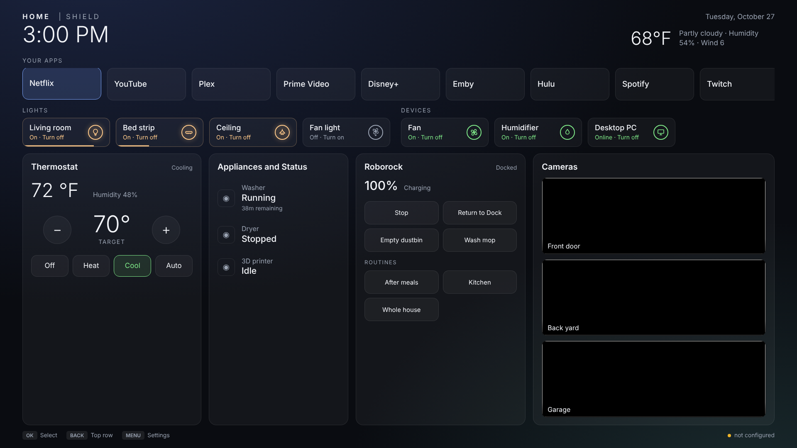

# Shield Home

A replacement home screen for NVIDIA Shield TV that puts your Home Assistant
dashboard next to your apps. No root, no ADB tricks beyond sideloading, and no
Lovelace dashboard to fight with.



- **Your apps**, in the order you choose, launched natively.
- **Home controls** — lights, switches, anything toggleable, with the state in
  words rather than an icon you have to decode from the couch.
- **Thermostat** with +/− setpoint and mode buttons, built for a D-pad.
- **Appliances** — washer, dryer, printer, with "43m remaining" where the
  integration provides a completion time.
- **Vacuum** — Stop, Return to Dock, dock maintenance, and a button for every
  routine your integration exposes, discovered automatically.
- **Cameras** as a live wall, any one of which fills the screen on OK.

Everything talks to Home Assistant directly over its WebSocket API. The TV
needs no add-on, no proxy, and no custom cards.

---

## Why not just show a Lovelace dashboard?

That was the first version, and it was abandoned for two reasons:

**Scale.** The Shield's WebView reports roughly 960 CSS pixels, so Home
Assistant lays out as though for a tablet. Cards come out enormous on a 55"
screen and a dashboard that fits a laptop needs scrolling on a TV.

**Focus.** Android's WebView has no spatial navigation. Arrow keys simply do
not move focus between Lovelace cards, so a remote cannot reach the controls.

Owning the markup solves both. The page is authored at a fixed 1920×1080 and
scaled to the panel in CSS, and it implements real two-dimensional D-pad
navigation: each press picks the nearest focusable element in that direction.

---

## Requirements

- NVIDIA Shield TV (built against Android 11 / API 30; developed on a 2019 Pro)
- Home Assistant reachable from the TV
- A long-lived access token
- `adb` on your computer

## Install

Download the APK from [Releases](../../releases), then:

```bash
adb connect <shield-ip>:5555
adb install -r shieldhome.apk
```

Configure it. Typing a token with a TV remote is miserable, so do it over adb:

```bash
adb shell am start -n com.shieldhome/.SetupActivity \
  -e url "http://192.168.1.10:8123" \
  -e token "eyJhbGciOi..." \
  -e finish true
```

Token: Home Assistant → your profile → Security → Long-lived access tokens.

Make it the home screen:

```bash
adb shell pm disable-user --user 0 com.google.android.tvlauncher
```

Press HOME, choose **Shield Home**, then **Always**.

To undo everything:

```bash
adb shell pm enable com.google.android.tvlauncher
adb uninstall com.shieldhome
```

## Configure what it shows

Which entities fill each panel is a JSON blob stored on the device. See
[`docs/example-entities.json`](docs/example-entities.json) for a complete one.

Push it as a file rather than passing it as an argument — `adb shell` hands
the whole command to a shell *on the device*, which re-parses the quotes and
newlines and mangles anything as long as this:

```bash
adb push my-entities.json /sdcard/Android/data/com.shieldhome/files/
adb shell am start -n com.shieldhome/.SetupActivity \
  -e entitiesFile my-entities.json -e finish true
```

That directory belongs to the app, so it needs no storage permission. It is
created the first time the launcher runs — if the push fails with *Is a
directory*, launch the app once and try again, or
`adb shell mkdir -p /sdcard/Android/data/com.shieldhome/files`.

`/sdcard/Download` also works, if that is easier:

```bash
adb push my-entities.json /sdcard/Download/
adb shell am start -n com.shieldhome/.SetupActivity \
  -e entitiesFile /sdcard/Download/my-entities.json -e finish true
```

| Key | What it does |
| --- | --- |
| `weather` | A `weather.*` entity. The block hides itself if unset. |
| `appOrder` | Apps to pin to the front, in order. Fuzzy matched. |
| `appLast` | Apps pinned to the very end. |
| `controls` | The toggle row. `status` optionally points at another entity for the indicator. |
| `climate` | One `climate.*` entity for the thermostat panel. |
| `appliances` | Status rows. `detail` may name a completion-time sensor. |
| `vacuum` | One `vacuum.*` entity. Its buttons are discovered. |
| `cameras` | Any number; they divide the panel evenly. |

App matching is deliberately loose, because installed labels rarely match what
you'd call them: `"HBO Max"` finds the app Android calls *Max*. Matching runs
one way only — a list entry may be longer than the installed name, never
shorter — or `"YouTube"` would also claim *YouTube Music*.

Press **MENU** on the remote at any time for the settings screen.

### Vacuum buttons

Stop and Return to Dock are core `vacuum` services. Everything else is
discovered: any `button.*` entity belonging to the vacuum becomes a tile,
keeping the name Home Assistant gave it. Dock maintenance (empty dustbin, wash
mop, dry mop) is matched by exact name and grouped at the top; everything else
is treated as one of your routines.

Matching is exact rather than by substring on purpose — a routine named
"Mop Hall" must not be mistaken for the dock's "Wash mop".

If your integration exposes no dock buttons, Empty Dustbin and Wash Mop fall
back to `vacuum.send_command` with Roborock's native commands.

### Cameras

Thumbnails are stills refreshed every two seconds, which costs almost nothing.
Maximizing one tries four transports in order and tells you which it got:

| Badge | Transport | Latency |
| --- | --- | --- |
| Live · Low latency | WebRTC, brokered by HA | Sub-second |
| Live · HD | HLS via the `stream` integration | 1–2s |
| Live | MJPEG (`camera_proxy_stream`) | Native rate, software decode |
| 1 fps | Still refresh | — |

WebRTC needs a Home Assistant new enough to broker it (2024.11+, which bundles
go2rtc). MJPEG is last-but-one deliberately: JPEG decoding is done in software
and a Tegra X1 struggles with it at full resolution.

---

## Build

```bash
echo "sdk.dir=/path/to/android-sdk" > local.properties
gradle assembleRelease
```

Needs JDK 17 and Android SDK 34. Output lands in
`app/build/outputs/apk/release/`.

The UI is `app/src/main/assets/home.html` — one file, no build step, no
framework. Editing it and reinstalling is the whole development loop.

| Path | What it is |
| --- | --- |
| `assets/home.html` | The entire UI: layout, HA WebSocket client, D-pad navigation |
| `MainActivity.kt` | Full-screen WebView, registers as Home |
| `HaBridge.kt` | `window.ShieldHome` — app list, icons, launching, config |
| `Config.kt` | On-device settings and the default entity map |
| `SetupActivity.kt` | Settings screen, also driveable over adb |

## Security

The token lives in the app's private `SharedPreferences`, written at setup
time. It is **not** compiled into the APK, so the built artifact carries no
credential and can be shared freely.

It is, however, held in plain text on the device and passed to the page, which
uses it for the HA WebSocket and camera URLs. That is the same posture as any
kiosk dashboard. Scope the token accordingly, and bear in mind that anyone with
physical access to the TV has your Home Assistant.

## Known limitations

- `QUERY_ALL_PACKAGES` is needed to enumerate the app row on API 30+. Fine for
  a sideloaded app; it would need justifying for a Play Store listing.
- The app row shows everything with a leanback launcher activity. Phone-only
  sideloaded apps won't appear.
- No tablet or phone layout. It assumes a 16:9 television.

## License

GPL-3.0-only. See [LICENSE](LICENSE).

Bundles [hls.js](https://github.com/video-dev/hls.js) under Apache-2.0; see
[NOTICE](NOTICE).

Not affiliated with Home Assistant, the Open Home Foundation, or NVIDIA.
